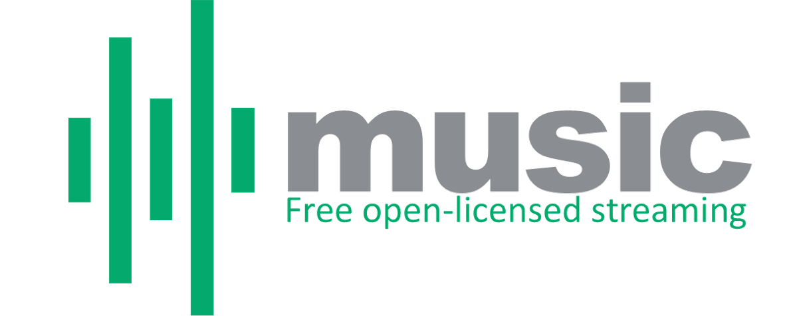

[](https://shannon-goddard.github.io/music/)
[](data/index.json)
[](LICENSE)
[](https://shannon-goddard.github.io/music/)
[](https://aws.amazon.com/q/)
[](https://shannon-goddard.loyal9.app/)

---

A free, open-licensed music player. 96,338 tracks from the Internet Archive, Jamendo, Freesound, and Wikimedia Commons. No account. No ads. No subscriptions. Install it to your home screen and it works offline.

**[→ Open the app](https://shannon-goddard.github.io/music/)**

---

## What you can do

- Stream music, podcasts, audiobooks, lectures, and interviews
- Browse by genre — 16 canonical genres, infinite scroll
- Radio mode — tap any genre, 50 shuffled tracks auto-play
- Search by artist, album, or song title (Fuse.js client-side)
- Save tracks to your library (stored locally, no login)
- Continue where you left off — position saved every 10s
- Works offline as a PWA — install to home screen
- Bluetooth / lock screen / car stereo controls via Media Session API
- Crossfade, playback speed, sleep timer in settings

---

## Sources

All content is public domain or Creative Commons licensed. Nothing is pirated.

| Source | Content |
|---|---|
| [Internet Archive](https://archive.org) | 7 collections — netlabels, 78rpm, opensource_audio, audio_music, georgeblood, audio_bookspoetry, librivoxaudio |
| [Jamendo](https://www.jamendo.com) | 35,025 CC-licensed tracks across 47 genre tags |
| [Freesound](https://freesound.org) | CC-licensed audio across 24 genre tags |
| [Wikimedia Commons](https://commons.wikimedia.org) | 17 genre categories, all public domain or CC |

---

## Local dev

```bash
python serve.py
# → http://localhost:8000/
```

That's it. No build step, no bundler, no dependencies to install.

---

## Data

| File | What it is |
|---|---|
| `cleaning/catalog_final.csv` | Source of truth — 96,338 rows, all 4 cleaning passes complete |
| `cleaning/CLEANING.md` | Full documentation of every cleaning pass |
| `data/genre/<genre>.json` | 16 static JSON chunks served to the frontend |
| `data/type/<type>.json` | 4 type chunks — audiobook, podcast, lecture, interview |
| `data/search-index.json` | Lightweight title + artist index for Fuse.js |
| `data/index.json` | Manifest — total counts, genre/type inventory |

---

## Architecture

Static JSON served from GitHub Pages with client-side Fuse.js search. No server, no database, no cold starts.

The project started as a full serverless stack (DynamoDB + Lambda + API Gateway) — fully built and working. After 4 cleaning passes the catalog landed at 96,338 tracks, too small to justify the infrastructure cost. Pivoted to static JSON.

Full blueprint, ingestion pipeline, data schema, and the full pivot story: **[project_architecture_technical_roadmap.md](project_architecture_technical_roadmap.md)**

---

## License

Code is [MIT](LICENSE). Music is CC-licensed per track — license and attribution for every track are in the ⓘ button in the player.

---

## Built by

**Shannon Goddard** — [shannon-goddard.loyal9.app](https://shannon-goddard.loyal9.app) · [GitHub](https://github.com/Shannon-Goddard) · Loyal9 LLC, Riverside CA

Every component built alongside **Amazon Q** (AWS AI pair programmer) from first line to first push.

[](https://www.buymeacoffee.com/goddardshannon9)
